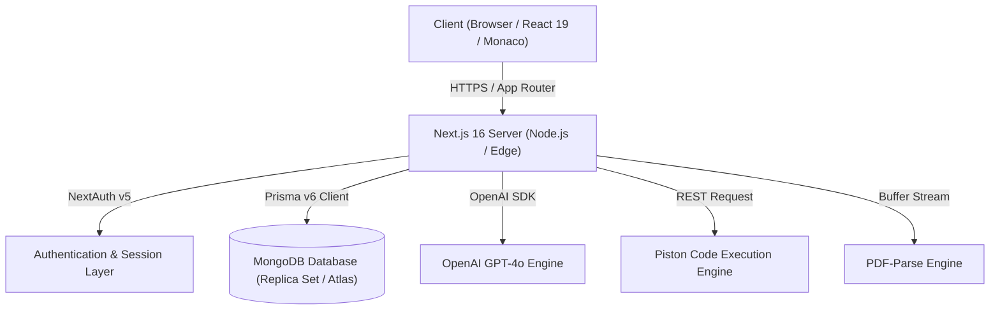

# PrepAI 🚀

### AI-Powered Mock Interviewer, ATS Resume Analyzer & Code Sandbox

[](https://nextjs.org/)
[](https://react.dev/)
[](https://www.typescriptlang.org/)
[](https://www.mongodb.com/)
[](https://www.prisma.io/)
[](https://tailwindcss.com/)
[](https://authjs.dev/)
[](LICENSE)

---

## 📌 Overview

**PrepAI** is an enterprise-grade AI preparation platform engineered to empower candidates with real-time technical and behavioral mock interviews, ATS resume scoring, and live code execution with algorithm analysis. Powered by **Next.js 16 App Router**, **React 19**, **Prisma ORM**, **MongoDB**, and **OpenAI GPT-4o**, PrepAI delivers instantaneous, hyper-personalized feedback to bridge the gap between candidate preparation and hiring standards.

---

## ✨ Core Features

| Feature                           | Description                                                                                                                                                                 |
| :-------------------------------- | :-------------------------------------------------------------------------------------------------------------------------------------------------------------------------- |
| **🤖 AI Mock Interviews**         | Dynamic behavioral, HR, and technical interviews simulated by an adaptive AI interviewer that evaluates response relevance, STAR methodology, and communication confidence. |
| **📄 ATS Resume Analyzer**        | Browser-side PDF resume parsing via `pdf-parse` with algorithmic ATS scoring, missing keyword detection, formatting audit, and actionable revision guidance.                |
| **💻 Live Coding Sandbox**        | Full-featured Monaco Code Editor paired with secure multi-language execution (Python, JavaScript, Java, C++) via Piston API and AI-driven Space/Time complexity analysis.   |
| **📊 Performance Analytics**      | Interactive radar skill charts and progress metrics built with Recharts, tracking technical competence, interview readiness, and historical performance.                    |
| **🛡️ Role-Based Admin Panel**     | Granular admin workspace to inspect platform user statistics, interview volume, system health, and user roles.                                                              |
| **🔐 NextAuth v5 Authentication** | Secure authentication supporting bcrypt password hashing, session cookies, and extendable OAuth providers (Google, GitHub).                                                 |

---

## 🏗️ Architecture & System Design



### Tech Stack Breakdown

- **Framework**: Next.js 16.2.6 (App Router, Turbopack, React Server Components)
- **UI & Styling**: React 19, Tailwind CSS v4, Lucide React, Framer Motion
- **Database & ORM**: MongoDB (with Replica Set support for transactions) & Prisma ORM v6
- **Authentication**: NextAuth.js v5 (Beta 31) with Prisma Adapter & BCryptJS
- **Data Visualization**: Recharts (Radar, Area & Bar Charts)
- **Code Execution**: Monaco Editor (`@monaco-editor/react`) + Piston API
- **Code Quality**: ESLint 9 (Flat Config), Prettier, TypeScript 5 Strict Mode

---

## 🗄️ Database Schema (MongoDB)

PrepAI utilizes 15 MongoDB collections managed seamlessly by Prisma:

```prisma
datasource db {
  provider = "mongodb"
  url      = env("DATABASE_URL")
}
```

- **User & Auth**: `User`, `Account`, `Session`, `VerificationToken`
- **Interviews**: `Interview`, `Feedback`, `Question`, `MockSession`, `MockSessionQuestion`, `MockSessionMessage`
- **Analytics & Skills**: `Skill`, `UserSkill`, `UserProgress`
- **Submissions**: `ResumeAnalysis`, `CodeSubmission`

---

## 🚀 Quick Start Guide

### Prerequisites

- **Node.js**: `v20.x` or `v22.x`
- **MongoDB**: Local MongoDB 6+ running with a **replica set** (required for Prisma transactions) OR **MongoDB Atlas**
- **Git**

---

### 1. Clone the Repository

```bash
git clone https://github.com/Anwar102006/prepai.git
cd prepai
```

### 2. Install Dependencies

```bash
npm install
```

### 3. Configure Environment Variables

Create a `.env` (or `.env.local`) file in the project root:

```env
# ─── Database ───
# For Local MongoDB Replica Set (port 27018):
DATABASE_URL="mongodb://127.0.0.1:27018/prepai?replicaSet=rs0&directConnection=true"

# OR For MongoDB Atlas:
# DATABASE_URL="mongodb+srv://<username>:<password>@cluster0.mongodb.net/prepai?retryWrites=true&w=majority"

# ─── NextAuth.js ───
NEXTAUTH_URL="http://localhost:3000"
NEXTAUTH_SECRET="your-super-secret-key-at-least-32-characters"

# ─── OpenAI ───
OPENAI_API_KEY="sk-your-openai-api-key"
OPENAI_MODEL="gpt-4o"

# ─── Application ───
NEXT_PUBLIC_APP_URL="http://localhost:3000"
NODE_ENV="development"
```

> [!NOTE]
> **Why does MongoDB need a Replica Set?**
> Prisma requires MongoDB replica sets to execute transactional queries (like user registration). If running MongoDB locally, start your instance with `--replSet rs0` and run `rs.initiate()`. For cloud deployments, MongoDB Atlas clusters are replica sets by default.

### 4. Push Prisma Schema to MongoDB

```bash
npx prisma generate
npx prisma db push
```

_(Optional) Seed initial skills and mock questions:_

```bash
npx prisma db seed
```

### 5. Start the Development Server

```bash
npm run dev
```

Open [http://localhost:3000](http://localhost:3000) in your browser.

---

## 🛠️ Available NPM Scripts

| Command                | Action                                            |
| :--------------------- | :------------------------------------------------ |
| `npm run dev`          | Launches Next.js dev server with Turbopack        |
| `npm run build`        | Builds optimized production bundle                |
| `npm run start`        | Starts production server                          |
| `npm run lint`         | Runs ESLint across all files (`--max-warnings 0`) |
| `npm run typecheck`    | Validates TypeScript types (`tsc --noEmit`)       |
| `npm run format:check` | Verifies code formatting with Prettier            |
| `npm run format`       | Auto-formats code with Prettier                   |
| `npm run db:push`      | Pushes Prisma schema changes to MongoDB           |
| `npm run db:studio`    | Opens interactive Prisma Studio GUI               |

---

## 📂 Repository Structure

```text
prepai/
├── .github/workflows/    # CI/CD Workflows (Lint, Typecheck, Build, Prettier)
├── docs/                 # Documentation (Project Report, Demo Script, PPT Guide)
├── prisma/               # Prisma Schema & Database Seeder
│   ├── schema.prisma     # MongoDB Collections & Schema Definitions
│   └── seed.ts           # Initial Data Seeder
├── public/               # Static Assets
├── src/
│   ├── app/              # Next.js App Router
│   │   ├── (auth)/       # Authentication Pages (Login, Register)
│   │   ├── admin/        # Admin Dashboard & User Management
│   │   ├── api/          # RESTful Route Handlers (Auth, Resume, Interview, Code)
│   │   └── dashboard/    # User Dashboard (Analytics, Coding, Interviews, Resume)
│   ├── components/       # UI Components & Modules
│   │   ├── auth/         # LoginForm, RegisterForm
│   │   ├── dashboard/    # StatCard, RecentInterviews, SkillChart
│   │   └── layout/       # Navbar, Sidebar, Topbar
│   ├── config/           # Site Constants & Plan Configurations
│   ├── lib/              # Prisma Client, Logger, Rate-Limiter, AI Prompts
│   └── proxy.ts          # Edge Middleware for Route Protection
├── next.config.ts        # Next.js Configuration & Security Headers
└── tsconfig.json         # TypeScript Compiler Configuration
```

---

## 🚢 CI/CD & Automated Checks

PrepAI includes robust GitHub Actions workflows under `.github/workflows/`:

- **Lint & Type Check**: Validates TypeScript typing (`npm run typecheck`) and ESLint rules (`npm run lint`).
- **Code Formatting Check**: Enforces Prettier standards (`npm run format:check`).
- **Automated Production Build**: Verifies that `npm run build` compiles all static and dynamic routes cleanly.

---

## 📄 License

This project is open-source and licensed under the [MIT License](LICENSE).
